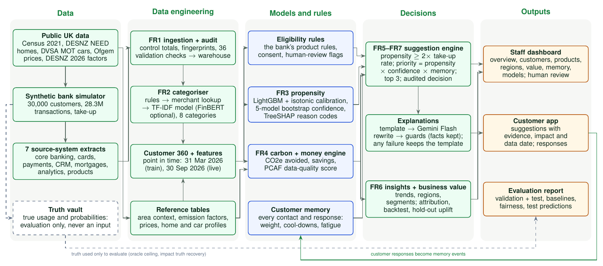

# Green Customer Insights Platform: design explainer

This document explains every data and architecture decision in our solution to PS1 (Green Customer Insights Platform,
Lloyds Banking Group), with the reason for each. It is written so that someone who has only read the problem statement can
answer questions about the solution. Section 15 is a FAQ of likely doubts.

Status labels: **[built]** = implemented and run on the 30,000-customer build (and tested on a 2,000 sample); **[planned]** = designed, not yet run.

---

## 1. The solution in one paragraph

We build the platform the way a Lloyds engineering team would: it only uses data Lloyds holds about its customers, plus
public data a bank may legitimately use. Because the brief forbids real personal or confidential banking data, we generate
a **synthetic but calibrated bank**: every simulated household first gets a physical reality (car, mileage, home, heating,
energy use) drawn from UK public statistics and public record-level data, and that reality then produces bank transactions
at the prices in force (weekly pump prices, quarterly Ofgem price caps). The bank's data arrives the way real bank data
does, as extracts from seven separate source systems with their own formats and quality problems; FR1 ingests and audits
them into a Customer 360. On top of that sit a transaction categoriser (FR2), propensity models with confidence and reason
codes (FR3), a carbon-and-money impact engine (FR4), explanations (FR5), business insights (FR6) and an evidence trail on
every recommendation (FR7). The simulator's hidden truth (true litres, kWh, take-up probabilities) is locked away and used
only to measure how good each stage is.

---

## 2. The problem as we read it

| Requirement | What the brief asks | Our component |
|---|---|---|
| FR1 Customer 360 | Combine all tables into one view per customer | Ingestion of 7 source systems + point-in-time Customer 360 |
| FR2 Categorisation | Exactly one of 8 mutually exclusive categories per transaction (Fuel, Electricity, Gas, Public Transport, Home Improvement, Automotive, Utilities, Other); document boundary decisions | Layered categoriser: rules citing boundary rules B1-B11, merchant lookup, text models |
| FR3 Opportunity detection | Per customer and product: propensity, confidence, reason codes | Calibrated LightGBM per product, confidence score, reason codes from feature contributions |
| FR4 Impact | Estimate impact with a documented method (GHG Protocol avoided emissions, PCAF financed emissions); don't invent a method | Deterministic engine on DESNZ 2026 factors, plus a money statement |
| FR5 Customer insight | Customer-friendly explanation from structured outputs only | Template explanations, optional LLM rephrasing behind guardrails |
| FR6 Business insights | Segments, propensity, regional and trend views, conversion opportunities, impact | Aggregates by region, segment and month; portfolio financed emissions |
| FR7 Explainability | Every recommendation states evidence, confidence, reason codes, data timestamp; never recommend what the data rules out | Eligibility blocks before ranking; evidence sentences; as-of date on every record |

Products: GP01 EV Finance, GP02 Green Home Loan, GP03 Solar Finance, GP04 Paperless Banking (required); GP05 Green
Investments, GP06 Green Loans (optional extensions, defined by us in `configs/products.yaml`); plus the optional
customer-memory extension (past responses change future recommendations).

What makes the problem hard, in our reading:
- **Spend is a noisy, partial signal of behaviour.** £80 at a forecourt is fuel (litres at that week's price) or a shop
  purchase; energy bills may be paid from another bank; fuel may be bought in cash. Suitability and carbon both depend on
  physical quantities, so we recover them explicitly.
- **Products overlap; categories do not.** A customer can suit several products (we model each product separately),
  while each transaction has exactly one category.
- **It is a regulated bank.** FCA Consumer Duty: vulnerable customers need extra care, credit and investment wording must
  not overpromise, and every number shown must be traceable.

---

## 3. Guiding principles (the reasons behind most decisions)

1. **Use only what Lloyds would have.** Every input to the models is either held by the bank (accounts, transactions, CRM,
   lending records) or public data a bank may legitimately use (area statistics, house price index, price caps, emission
   factors). Anything else exists only inside the simulator.
2. **Real where public record-level data exists; simulated only where data is private by nature.** Homes come from real
   anonymised homes (DESNZ NEED), car ages and mileage from real MOT tests (DVSA), prices from real weekly and quarterly
   series. Only the bank relationship (accounts, statement lines, product take-up) is simulated, because no public dataset
   has it.
3. **Physics first, money second.** The simulator decides litres, kWh and miles, then turns them into payments. That keeps
   spending physically consistent and lets us check the carbon engine against true quantities.
4. **A hidden truth vault.** The simulator records what really happened; models never see it; evaluation does. This gives
   honest accuracy figures, including a ceiling no model can beat.
5. **Explainable by construction.** Every field has a section, a purpose and a consumer; every recommendation carries its
   reasons, evidence, confidence and date.
6. **Reproducible.** Fixed random seed (20261010); every public file is recorded with its URL, licence and checksum.

---

## 4. Data: three layers

| Layer | What is in it | Would Lloyds have it? | Used by models? |
|---|---|---|---|
| 1. Lloyds' own systems (7 source systems) | Customers, accounts, balances, card and payment transactions, CRM campaigns, app analytics, product holdings, mortgage valuations with EPC register match, car-finance vehicle records | Yes | Yes |
| 2. Public data a bank may legitimately use | Census 2021 area statistics, DESNZ energy averages, DfT vehicle shares, PVGIS solar yield, UK House Price Index, Ofgem caps, pump prices, DESNZ emission factors | Yes (public) | Yes, as area-level context, labelled as describing the area, not the person |
| 3. Simulation truth | The real home and car behind each customer (from NEED and MOT records), true usage, hidden traits, take-up probabilities | No | Never; evaluation only |

Why this split: it lets us be realistic (layer 3 makes the world real) without pretending the bank knows things it cannot
(layers 1 and 2 are all the models see). Anonymised public records (NEED homes, MOT tests) cannot be linked to real customers,
so they shape the hidden world, not the bank's view; their aggregates are legitimate public statistics.

---

## 5. Public data we use, and why

| Dataset (publisher) | What it gives | Where it is used |
|---|---|---|
| Census 2021 (ONS via Nomis): tenure, accommodation, cars, commute, heating, household size; plus household composition, bedrooms, economic activity, occupation, distance to work, deprivation, health, disability; cross-tables RM201 (tenure x age of household head) and RM133 (tenure x economic activity) | Who lives where, per local authority | Population sampling; area context in the 360; validation |
| NEED 2025 anonymised sample (DESNZ), 4 million homes | Real homes: type, age, floor area band, EPC band, insulation, solar, metered gas and electricity | Each simulated home is a real NEED home of the same region, type and heating |
| Sub-national electricity and gas use (DESNZ) | Average household kWh per local authority | Re-anchors each home's use to its area; validation |
| Renewable electricity by area (DESNZ) | Solar installations per local authority | Which homes have solar; validation |
| VEH0105 and VEH0142 (DfT) | Car fuel mix per local authority, incl. electric and plug-in hybrid | Each car's fuel; local EV share; validation |
| National Travel Survey NTS0901/0904 (DfT) | Average annual mileage by fuel; mileage bands | Overall mileage level |
| Anonymised MOT results 2024 (DVSA), 9.25 million tests from 4 months | Car age and lifetime-average annual mileage by fuel | Car age mix (cars aged 3+); how mileage falls with age; validation |
| Weekly road fuel prices (DESNZ) | Petrol and diesel pence per litre | Prices every fill-up; converts fuel spend back to litres |
| Energy price cap (Ofgem), 2025 Q1 to 2026 Q4 | Unit rates and standing charges | Energy bills; converts bills back to kWh |
| PVGIS (EU Joint Research Centre) | Solar yield per kW of panels, per region | Solar output; solar reason code; solar carbon and money |
| UK House Price Index (HM Land Registry) | Monthly average prices by local authority and property type | Property value at mortgage start; current indexed value and loan-to-value |
| Quoted household rates (Bank of England) | Mortgage rates by LTV and fixed period, personal loans, cards, overdrafts, savings | Product rates and repayments |
| Family Spending, table A6 (ONS) | Spend by category and income decile | Incomes and everyday spending; validation |
| GHG conversion factors 2026 (DESNZ) | Emission factors | Carbon engine |
| GHG intensity by industry (ONS) | Emissions per £ of output, 21 sectors | GP05 fund footprints |
| Merchant category codes (ISO 18245 list) | Card merchant codes | Merchant directory and categoriser rules |

Benchmarks, used only to test methods (never to build the bank): DoDataThings (68,000 US transaction descriptions) for the
categoriser out-of-distribution test; UCI Bank Marketing (45,211 clients, term-deposit take-up) as a real take-up benchmark
[planned]. Downloaded for real-data proofs [planned]: MoneyData (a real anonymised UK current-account statement, 6,567 lines,
already categorised, CC BY 4.0) to test the categoriser on real UK narratives; the Berka/PKDD'99 Czech bank (8 tables,
1,056,320 transactions) to show the FR1 join works on a real multi-table bank. EPC register certificates are pending a
download by the team.

**What we deliberately did not do: stitch other datasets' customer, loan and transaction records together.** Joining
records of different people on shared fields (age, income, region) invents people who never existed, and the only link
between the joined parts is those few fields. Public transaction datasets are foreign or old (US, Czech 1999, Spanish
simulations) and mostly simulated themselves, and none has green-product take-up, so labels would still have to be
modelled.

---

## 6. How the synthetic bank is generated (and why each step is the way it is)

1. **Population.** Each customer is the main account holder of one household. Pick a local authority in proportion to its
   households; draw tenure from its Census shares; age so that the share of household heads aged 65+ matches Census RM201
   for that area and tenure; economic activity fitted to RM133 by region and tenure; household size, dependants (TS003),
   occupation (TS063), self-employment (TS066), cars and commute from Census. *Why:* realistic joint distributions, not just
   realistic marginals.
2. **Hidden traits.** Five standard-normal traits per customer (green attitude, spare cash, plans to stay, digital comfort,
   risk appetite), partly linked to observable characteristics. *Why:* real take-up depends on things a bank cannot see;
   without hidden traits a simple rule could reproduce the labels and the modelling would be trivial.
3. **Homes.** Each home is a real NEED home of the same region, property type and heating (gas or not), chosen with a tilt
   toward higher council-tax bands at higher incomes. It brings construction period, floor area band, EPC band, insulation and
   metered gas and electricity, re-anchored to the local authority's DESNZ averages. Homes whose NEED record has no EPC keep a
   true rating but have no certificate the bank can match. *Why:* real heterogeneity in energy use, which drives GP02 and
   GP03 and the carbon numbers.
4. **Cars.** Fuel from the local DfT mix (tilted by green attitude, income, off-street parking); age from the MOT age mix
   for that fuel (cars under 3 years: an assumed share per fuel, because MOT starts at 3 years); mileage from NTS bands with
   MOT's age pattern, rescaled to the NTS national average. *Why:* GP01 depends on fuel bought and car age.
5. **Money.** Income within ONS decile ranges; mortgages valued at the House Price Index for area, type and purchase month,
   with loan-to-value at purchase (assumption), amortised at the Bank of England rate for the current fixed deal; personal
   loans, cards and savings at Bank of England rates; everyday spending from ONS by income decile.
6. **Life events.** Moves, new cars, babies, retirements, drawn month by month.
7. **Take-up labels.** For each product: logit P(take-up between 1 Apr and 30 Sep 2026) = b0 + sum(beta x true driver on
   31 Mar 2026) + sum(gamma x hidden trait), only for truly eligible customers; b0 solved so take-up among the eligible hits a
   target (GP01 5.5%, GP02 4.5%, GP03 3.5%, GP04 12%, GP05 6%, GP06 3.5%). Products are drawn independently, so they can
   overlap. *Why:* documented, causal, not LLM-made, and the exact probability is stored, giving an honest ceiling.
8. **Transactions.** Litres x that week's pump price; kWh x the Ofgem cap in force plus standing charges; everyday spend;
   318 named UK payees plus about 27,000 local businesses; rendered as Open Banking-style statement lines (truncated
   narratives, card last four digits, merchant codes on about 97% of card payments). About 45 transactions per customer per
   month.
9. **Deliberate blind spots.** About 14% pay energy from another bank, about 10% of drivers pay some fuel in cash, 8% buy fuel
   on another bank's card, about 10-12% have out-of-date onboarding answers. *Why:* a real bank sees only part of a
   customer's life; this makes coverage and confidence meaningful.
10. **Seven source systems.** The bank's records are exported as: core banking (CSV: customers, accounts, balances; codes,
    YYYYMMDD dates, money in pence, rates in basis points), card processor (Parquet; card tokens, not account numbers; about
    0.2% replayed rows), payments hub (gzip CSV; signed pounds, DD/MM/YYYY, legacy account-number formats), CRM (contact ids
    with a crosswalk; duplicate contacts; prospects; outcome spellings), digital analytics (JSON lines; pseudonymised ids;
    orphan records), lending assets (XML property valuations with EPC match; CSV vehicle records), product system
    (holdings, statement-preference events), plus a control file of row counts and SHA-256 checksums. *Why:* the brief says
    real data comes from separate tables and sources; FR1 should do real integration work.

Validation (30,000-customer build): **36 of 36 checks** against public statistics within tolerance, including tenure
(Census), flats and car-free households (Census), mains gas heating (Census), battery-electric share (DfT), solar share
(DESNZ), mean mileage (NTS), gas and electricity use (DESNZ), fuel, food and energy spend by income (ONS), household-head age
and activity by tenure (Census RM201, RM133), dependants (TS003), bedrooms (TS050), EPC coverage and ratings (NEED), mortgage
rates (Bank of England), and car age and the mileage fall-off with age (MOT).

---

## 7. FR1: from seven source systems to one view per customer

Ingestion steps, in order:
1. **Control check:** each file's size and SHA-256 before parsing, row counts after; any mismatch stops the load.
2. **Harmonise:** one convention (ISO dates, pounds, rates as fractions, readable codes).
3. **Match identifiers:** account numbers (current and legacy formats) to accounts; card tokens via the card registry;
   CRM contact ids via the crosswalk (two ids for one person are merged); pseudonymised analytics ids by recomputing each
   customer's id with the shared salt.
4. **Deduplicate and quarantine:** replayed card rows removed; records matching no customer (prospects, orphans) kept in
   `quarantine/` with the reason, never silently dropped.
5. **Write:** the warehouse is built in a staging folder and swapped in only when complete; an ingestion report and a
   column lineage table record where every column came from and how it was transformed.
6. **Audit:** the truth vault holds a fingerprint of each table as the bank held it and a hash of every transaction.
   Result: every table identical and every transaction recovered with every field identical (28,266,495 transactions in
   the 30,000-customer build); 13 automated tests include three that tamper with data on purpose and are caught.

Then the **Customer 360** is a point-in-time join: one row per customer per snapshot date, using only data dated on or
before that date. Two snapshots: **31 March 2026** (training: labels come from the six months after) and **30 September
2026** (live scoring).

### Customer 360: 69 fields in 9 sections

| Section | Fields | Question it answers | Who reads it |
|---|---|---|---|
| keys | 2 | Which customer, as of which date | every stage |
| who_they_are | 10 | Age, income band, employment, residential status, years at address, years with the bank, consent, vulnerability, channel, sustainability preference | models (context only, never a reason), fairness audit, recommendation gating |
| where_they_live | 9 | Area and region, plus 6 public area statistics (car-free homes, EV share of cars, average gas and electricity use, solar uptake, solar yield) | models, carbon engine, regional insights |
| what_they_hold | 10 | Product counts, paper accounts, property value at origination, current loan-to-value, months left on a car loan, personal-loan purpose | eligibility rules, models, PCAF financed emissions |
| green_products_held | 6 | Green products already held | "already holds" blocks, conversion insights |
| money_health | 8 | Balances, months overdrawn, arrears, transaction count | affordability and difficulty blocks, confidence |
| home_and_car_on_record | 8 | What the bank knows as lender: property type, construction period, floor area, EPC, heating, solar, car fuel and age | eligibility rules, carbon engine, reason codes |
| how_they_bank | 4 | Logins, app share, e-statements | Paperless product, delivery channel |
| what_we_said_before | 12 | Last response to each product and its date | customer memory (cool-downs) |

Why it has 69 fields and not 10: FR1 asks for one view combining all tables, and five different consumers read different
parts of it (eligibility rules, models, the impact engine, customer memory, bank insights). We pruned it from 114 to 82 by
removing constants, duplicates, leaks and anything no consumer reads, then to 69 after searching the rule, model, impact,
recommendation and explanation code for every field and dropping the ones nothing read (six area statistics, two account
counts, two loan balances, the indexed property value, the car value at origination and total spend). It is "wide underneath, simple on top": a model sees
about 30 fields per product, a customer sees 3-5 facts, the bank sees aggregates.

Rules attached to fields: the vulnerability flag is never a model input (it routes credit offers to human review); area
fields describe the area, not the person, and are never shown to a customer as a fact about them; health and disability
statistics are excluded entirely; declared fields can be out of date, so transaction evidence usually beats them.

---

## 8. The four dataset files downstream uses, and why there are four

| File | Grain and key | Columns | What it is | Why it is a separate file |
|---|---|---|---|---|
| `customer_360_<as_of>.parquet` | one row per customer per snapshot; `(customer_id, as_of)` | 69 | FR1 output: everything the bank knows about the customer, in 9 sections | The single customer record; it exists without transaction categorisation |
| `features_<as_of>.parquet` | same key | 65 (2 keys + 63 features in 6 sections) | Point-in-time features from categorised transactions: spend by category, fuel litres and km, electricity and gas kWh, coverage flags, evidence flags (homeowner, EV owner, financial difficulty...) | Depends on FR2 output and is rebuilt when the categoriser changes; joined to the 360 on the key, the pair is what models and rules read |
| `categorised/part-*.parquet` | one row per transaction; `transaction_id` | 13 | FR2 output: every transaction with exactly one of the 8 categories, a sub-category, a confidence and the layer that decided | Transaction-level evidence and drill-downs ("you spent £1,240 on fuel"), monthly trend insights; too big and too granular for the customer record |
| `labels` | one row per customer per product; `(customer_id, product)` | 5 | Take-up between 1 Apr and 30 Sep 2026, from the bank's own product system (a green product opened in the window), plus the customer's split | Training target only; kept apart so no model input can contain it |

Feature sections: history (coverage of months seen), spend_by_category (the FR2 view), how_they_travel (fuel bought,
distance, charging, car costs), home_energy (kWh and heating), home_situation (own/rent/move, home spending),
income_and_finances (income, investing, borrowing, financial health).

Two features worth explaining: **price normalisation** turns money into physical quantities at the price in force when each
payment was made (fuel spend / that week's pump price = litres; energy bill minus standing charge / that quarter's unit rate =
kWh), so a price rise is not mistaken for more driving or heating. **Coverage flags** say how much of a quantity is visible
(e.g. energy bills seen in 10+ of 12 months), which feeds confidence and the data-quality score.

Splits: each customer is assigned train (70%), validation (15%) or test (15%) by a salted hash of the customer id, so all of
a customer's rows sit in one split. Fit on train, tune on validation, report on test.

Labels come from the bank's own product system, not from the simulator: a customer "took up" a product if a green product
holding started in the label window. On the synthetic bank this reproduces the simulator's labels exactly (3,975 of 3,975
take-ups on the 30,000-customer build, same dates; all 180,000 customer-product rows agree).

---

## 9. Architecture: the pipeline



Source: `docs/architecture/architecture.tex` (TikZ; `architecture.pdf` and `.png` are built from it with pdflatex).

```
Public data (57 files) --> reference tables (Census, NEED, MOT, prices, factors ...)
        |
        v
Synthetic bank simulator --> 7 source-system extracts + truth vault (hidden; evaluation only)
        |
        v
FR1 ingestion + audit --> warehouse --> validation (36 checks) + data card
        |
        v
Customer 360 (2 snapshots) --> FR2 categoriser --> categorised transactions --> features
        |
        v
Eligibility rules --> FR3 propensity, confidence, reason codes --> FR4 carbon + money impact
        |                                                       customer memory (CRM + app responses)
        v                                                               |
FR5-FR7 suggestions (threshold, memory, routing, human review) <--------+
        |
        v
explanations (template -> Gemini Flash rewrite -> guards) --> customer app --> responses --> memory
        |
        v
FR6 insights + business value --> staff dashboard;  evaluation report (validation + test) --> docs/EVALUATION.md
```

Every stage writes a checkpoint, so a restarted job resumes where it stopped. Everything runs on one laptop (14 GB RAM,
12 CPU cores, a 6 GB GPU): the 30,000-customer data build takes about 25 minutes and the pipeline about 8 minutes
(`scripts/run_pipeline.py`: propensity, impact, recommend, explain, impact checks, memory replay, insights, business
value, LLM evaluation, evaluation report, report). The dashboard (`scripts/serve_dashboard.py`) serves the bank view and
the customer view; `scripts/predict.py` scores with the saved models. [built]

---

## 10. FR2 categoriser [built]

Layers, in order: **rules** (merchant codes and text patterns, each citing a boundary rule; they fire only when
near-certain), **merchant lookup** (exact normalised text seen in training with at least 95% purity), then an **ensemble of
text models**: character and word TF-IDF with a linear model (default), and optionally sentence embeddings, **FinBERT**
embeddings (ProsusAI/finbert, mean-pooled, with a logistic-regression head for this taxonomy) or a fine-tuned DistilBERT;
the ensemble weights are chosen on validation transactions from merchants never seen in training. The model predicts a
sub-category; its category is the roll-up, so every transaction gets exactly one of the 8 categories.

FinBERT was tested head to head on the 2,000-customer build (model layer alone, no rules or lookup): seen merchants 99.3%
vs TF-IDF 99.1%; merchants never seen in training 76.4% vs 83.1% (test) and 77.9% vs 85.7% (validation); about 8 minutes
on a laptop GPU against about 1 for TF-IDF. The validation search gave FinBERT a weight of zero in the ensemble, so TF-IDF
stays the default and FinBERT is an option (`scripts/build_model_inputs.py --finbert`). A likely reason: FinBERT was trained
for financial sentiment on news, while merchant strings ("TESCO STORES 3412") are best matched by character n-grams.

Boundary rules (B1-B11, documented in `configs/taxonomy.yaml`), for example: public EV charging is Fuel (B2); forecourt shop
purchases are Other (B3); dual-fuel bills and delivered heating oil are Utilities (B4); prepayment top-ups follow the meter
(B5); clean-air charges are Automotive (B6); taxis are Other but bike hire is Public Transport (B7); appliances are Home
Improvement (B8); supplier refunds keep the supplier's category (B10); housing payments are Other (B11).

Evaluation splits merchants as well as customers: 20% of merchants never appear in training, so accuracy on them measures
generalisation. Result on the 30,000 build (TF-IDF): 99.0% category accuracy on seen merchants, 90.4% on unseen; the
weakest boundary is Electricity/Gas vs Utilities when a bill names no fuel (rule B4). Out-of-distribution check on 68,000
US descriptions: 82-85% coarse agreement.

---

## 11. FR3 propensity, confidence and reason codes [built]

- **Who is scored:** only customers the eligibility rules allow for that product (FR7: never recommend what the data rules
  out). On the 2,000 build the rules keep 95-97% of real take-ups for GP01, GP02, GP03 and GP06; 83% for GP04 (vulnerable
  customers are deliberately not nudged off paper); 69% for GP05 (people investing elsewhere without visible transfers
  cannot be seen).
- **Inputs:** a curated list per product (its reason-code features, a shared context set such as age, income band, tenure,
  balances, digital activity, and a few product extras such as local EV share for GP01), about 20-40 features, not all 150.
- **Models:** a rules baseline and a logistic regression for comparison; LightGBM tuned by random search on train, scored on
  validation by average precision.
- **Calibration:** out-of-fold isotonic calibration on train, so a propensity of 0.2 means about 1 in 5.
- **Confidence** = sqrt(data coverage) x 1 / (1 + coefficient of variation across a five-model bootstrap ensemble): high when
  the evidence is visible and the models agree.
- **Reason codes:** LightGBM's per-feature contributions (TreeSHAP), summed over the features mapped to each fixed reason
  code (e.g. HIGH_FUEL_SPEND, HIGH_ANNUAL_MILEAGE, EXISTING_VEHICLE); the codes that push the score up are reported, each with
  an evidence sentence from the customer's own data. Demographic fields can inform the score but are never a reason.
- **Metrics on test:** ROC-AUC, PR-AUC, Brier score, expected calibration error, lift in the top 10%, and the share of the
  gap to the oracle closed (the simulator's exact probability is the best possible score, used only for evaluation).
- **Fairness:** metrics and selection rates by age band, income band, region and vulnerability.
- **Ablations:** price normalisation off, coverage flags off, calibration off, memory off, all features instead of curated.

Signal check on the 2,000 build (cross-validated, 20-65 buyers per product): AUC 0.61-0.83 against a best possible
0.80-0.89. Real metrics come from the 30,000 run.

---

**Output record.** Every suggestion is a record in the brief's format: `customer_id`, `opportunity` (EV_FINANCE,
GREEN_HOME_LOAN, SOLAR_FINANCE, PAPERLESS_BANKING, GREEN_INVESTMENTS, GREEN_LOANS), `propensity`, `confidence`,
`reason_codes` (fixed identifiers such as HIGH_FUEL_SPEND, HIGH_ANNUAL_MILEAGE, EXISTING_VEHICLE), `evidence` (one
sentence per code from the customer's own data) and `data_timestamp`, plus the impact. A reason code is reported only
when the customer's data supports its sentence: a feature can raise a score through its absence (no gas bills make a
heat pump more likely for an oil-heated home), and "HIGH_GAS_USE: about 0 kWh" would mislead, so such a code is skipped
and the next strongest supported one is used (244 of 5,437 suggestions end up with no code and show "overall fit").

## 12. FR4 impact engine: carbon and money [built]

Deterministic (same inputs give the same output). Carbon uses DESNZ 2026 factors on a **well-to-wheel** boundary
(combustion or generation, plus upstream fuel production, plus grid losses): petrol 2.656 kg CO2e per litre, diesel 3.195,
natural gas 0.2125 per kWh, grid electricity 0.1844 per kWh, heating oil 3.071 per litre.

- **Customer lens:** avoided emissions per year and over the product's horizon (GHG Protocol / WBCSD avoided-emissions
  framing), from the customer's own litres and kWh where visible, else a documented fallback.
- **Bank lens:** PCAF financed emissions avoided where PCAF covers the asset (motor loans, mortgages; fund footprints as a
  proxy for GP05); attribution = outstanding loan / value at origination.
- **Data-quality score 1-5** (PCAF-style; 1 is never claimed because spend-derived volumes are estimates): e.g. GP01 is 2 when
  the vehicle is on record and fuel is seen in 10+ months, down to 5 when only an average car can be assumed.
- **Insufficient data:** when a method's inputs are missing, the status is `insufficient_data` and no number is shown.

| Product | Method |
|---|---|
| GP01 EV Finance | Litres bought x fuel factor, vs the same distance in an electric car (0.205 kWh/km x grid factor); money: fuel cost vs charging cost (home share at the Ofgem unit rate, public charging at £0.70/kWh); excludes the car price |
| GP02 Green Home Loan | Gas-heated houses: heat pump replacing the boiler (boiler efficiency 0.84, heat pump seasonal efficiency 2.93); others: insulation saving 20% of heating; money: bills before vs after, upfront cost after the Boiler Upgrade Scheme grant (£7,500; £9,000 for oil and LPG homes from 21 Jul 2026 to 31 Mar 2027), payback |
| GP03 Solar Finance | 4 kWp x regional PVGIS yield x 0.9 orientation factor, displacing grid electricity; money: self-used power at the unit rate plus exported power at a Smart Export Guarantee rate; payback |
| GP04 Paperless | Paper and postage per statement x statements per year x paper factor; no money effect |
| GP05 Green Investments | A quarter of holdings moved from a broad UK equity fund to a sustainability-focused fund, footprints from ONS emissions per £ of output by sector; no money projection (capital at risk; information, not advice) |
| GP06 Green Loans | E-bike replacing 2,000 km of car trips, an efficient appliance (150 kWh/yr), or a home charger (cost only), chosen by the customer's evidence |

Prices are those in force on the as-of date (30 Sep 2026: electricity 26.11p/kWh, gas 7.33p/kWh, petrol 173.5p/litre).
Every non-sourced number is labelled as an assumption in `configs/carbon.yaml`. [built] Checks: the litres and kWh the
engine reads from transactions against each customer's true usage in the truth vault (fuel litres within 20% for 83% of
drivers, r = 0.95; gas and electricity within 20% for only 39%, because direct debits smooth bills); a one-at-a-time
sensitivity table (for example, km per litre moves the EV money statement by 82% over its range); and a golden case
worked by hand from the DESNZ factors and prices (1,000 litres of petrol: 2,656 kg baseline, 2,170 kg avoided, £873 a year
less), checked by an automated test.

**Estimate confidence (how data quality is shown).** Each estimate carries a PCAF data-quality score from 1 (verified
data) to 5 (averages only); 1 is never claimed. Because "1 is best" reads the wrong way round, people see it turned into
estimate confidence: score 2 = High (●●●●), 3 = Good (●●●○), 4 = Partial (●●○○), 5 = Low (●○○○), with what it rests on
from `configs/carbon.yaml` (for EV Finance: High = the car is on our books and fuel was bought in 10+ of the last 12
months; Low = only evidence of a car, so national average mileage is used). The PCAF score stays in every record.

An honest finding the engine surfaces: at 2026 prices (electricity about 3.6x the price of gas), heat pumps cut a lot of
carbon but save little money, so their payback is long; the platform says so instead of overselling.

---

## 13. FR5-FR7 recommendations and explanations [built]

Order of decisions for each customer and product, each recorded for audit:
1. eligibility blocks (fixed block ids such as NO_VEHICLE, RENTER, TOP_EPC_RATING, SOLAR_FITTED, IN_ARREARS);
2. no marketing consent: nothing is sent;
3. memory: "already have" suppresses; "not interested" (180 days) and "dismissed" (90 days) start cool-downs; "clicked"
   raises priority;
4. thresholds: the carbon and money impact can be estimated; calibrated propensity is at least 2x the product's take-up
   rate among eligible training customers (so a shown customer is at least twice as likely as average; test lift 2.2-4.3x);
   confidence is not "low" (>= 0.45); the product avoids at least 100 kg CO2e a year (Paperless exempt: small by nature).
   Why relative and not e.g. 50%: six-month take-up rates are 2-12%, so almost no customer is above 50%; what matters is
   how much likelier than average, and calibration makes "2x the take-up rate" mean the same on every product. The
   earlier fixed 2% floor let in customers no likelier than average (27,461 suggestions; now 5,437);
5. GP06 Green Loans steps aside when GP01, GP02 or GP03 is recommended;
6. rank by propensity x confidence, at most 3 per customer (the business view also keeps expected kg CO2e avoided);
7. credit products for customers with a vulnerability flag go to human review instead of being sent.

Each recommendation record holds product, propensity, confidence, reason codes, evidence sentences, the carbon and money
statement, data-quality score, method, and the data timestamp (FR7).

Explanations (FR5) are generated from that record only. Every recommendation gets a deterministic template explanation:
a body (why, what it changes, what it costs) and a fixed compliance sentence (the data date, "prices and your situation can
change", and the GP05 disclaimer). All 5,437 templates on the 30,000 build pass the guards.

The LLM is optional and nothing about it is trained (the trained models are the FR2 categoriser and the FR3 LightGBM propensity models). Full details, with the prompts word for word: `docs/LLM.md`. Two
roles: in the dashboards, "Rewrite" uses Gemini Flash through the Gemini API (`llm.provider: gemini`, model
gemini-3.8-flash, falling back to gemini-3.5-flash and gemini-3.1-flash-lite when a model's daily quota is used up; only
the explanation text and its facts are sent, no identifiers; replies are cached on disk). The 360-item evaluation below
runs an open model (Qwen2.5-1.5B-Instruct) offline on the laptop GPU (`--llm-provider local`), because a free-tier
Gemini key allows only about 20 requests a day per model: of 17 Gemini 3.8 Flash replies before the quota ran out, 16
passed every guard (the one failure wrote 13,033 for 13,003, caught by the number check); with the current prompt and
per-product examples, a later sample passed 12 of 12 (gemini-3.5-flash and gemini-3.1-flash-lite). Either way the LLM rewrites only the body; the compliance
sentence is appended unchanged, the way banks treat disclosures. Guards reject any rewrite that adds a number not in the facts, drops a number from the draft, turns a yearly or
12-month figure into a monthly one, promises savings, approval or returns ("will save", "guaranteed", "perfect for you"),
or is too long; a rejected rewrite falls back to the template. Why each guard exists: the first run passed 0 of 360
because the model reformatted the date and paraphrased the caveat; after moving the compliance sentence out of the LLM's
reach, a run passed 97%, but reading them showed "£1,337 on fuel each month" (really 12 months) and an invented 12-month
payback slipping through, so the completeness and time-period guards were added. Result on the 360-item evaluation set
(60 per product, local Qwen2.5-1.5B): 89.7% pass (EV Finance 92%; it was 22% while the prompt's only worked example
was a solar one, and Green Investments rewrites spoke as the bank, "our investments", until the evidence sentences were
written in the second person with a verb, "you told us sustainability matters to how you invest"); reading ease is lower for LLM text (67 vs 73 Flesch), so templates remain the default and the
LLM is offered in the dashboard as an on-demand rewrite.

---

### FR6 bank insights, customer memory and the dashboard [built]

FR6 (`src/gcip/insights/bank.py`) aggregates the live snapshot, never showing individual customers: opportunity per
product (eligible, shown, expected take-ups = sum of calibrated propensities, expected CO2e avoided = propensity x avoided
emissions, typical money impact and payback), the decision funnel (why each customer x product was or was not shown),
regions (footprint and opportunity per customer), the visible footprint by income band and its distribution, six k-means
segments on behaviour (named from their strongest traits, e.g. "customers who own their home and bank digitally"), and
monthly spend by FR2 category, nationally and by region, and trend views built from sub-categories: customers using public EV charging each month (it doubles over the period), spend at energy installers (it jumps when take-ups start paying installers), bike hire, rail and bus, heating oil; road fuel spend against litres at that month's pump price (price normalisation made visible); home energy bills; and green product take-ups per month in the observed window. On the 30,000 build: 5,437 suggestions for 4,792 customers,
expected 914 take-ups, 1,242 t CO2e a year avoided, and £419k a year of customer savings.

Customer memory (`src/gcip/memory/signals.py`) is a dynamic signal, not just the last answer. The memory store is one
event log: the CRM's campaign history (five waves: May 2025, October 2025, February 2026, June 2026 and August 2026; the
last two fall after the training date, so they only affect the live snapshot) plus every response given in the apps.
From every contact and response in the last 12 months it derives, per customer and product:

- a **memory weight**: the product of a factor per event (interested ×1.5, seen without acting ×0.85, no response ×0.7,
  dismissed ×0.5, not interested ×0.2; bounded to ×0.05-×2.0). The suggestion's priority is propensity × confidence ×
  memory weight, so memory reorders suggestions without ever changing the model's propensity, the eligibility rules or
  the carbon estimate (the brief's guardrail for memory);
- **contacts in a row with no engagement**: after 3, the product is paused for 180 days however strong its propensity
  ("no interest after 3 contacts"); any engagement resets the count;
- **explicit answers** with fixed effects:

| Response (app button) | Meaning | Effect |
|---|---|---|
| clicked (the call to action, e.g. "Explore EV options") | interest: a lead for the product team, not an application | weight ×1.5, resets the no-interest count |
| no response / seen without acting | the customer did nothing | weight ×0.7 / ×0.85; 3 in a row pause the product 180 days |
| dismissed ("Remind me later") | not now | weight ×0.5; paused 90 days |
| not_interested ("Not for me") | not this product | weight ×0.2; paused 180 days |
| already_have ("I already have this") | holds it already, possibly with another bank; our data missed it | stopped for good |

None of these is a take-up: a take-up exists only when the product is opened in the bank's product system (which is
also where the training labels come from). On 30 September the CRM history pauses 2,574 customer × product pairs after
"dismissed" or "not interested", stops 564 (already has it), pauses 31 for no interest after 3 contacts, raises the
weight of 3,167 and lowers 29,744. Against the same engine with an empty memory, memory hides 57 suggestions, brings 1
into a customer's top 3 and reorders 43. Earlier interest is also a reason code, EARLIER_INTEREST, with its date as
evidence ("showed interest in this on 2025-10-22"; 375 suggestions), in line with FR7's evidence and timestamps; every
reason section and record also states the evidence window (1 October 2025 to 30 September 2026). An app response can be undone. The
staff view shows per product the contacts, the no-interest count, the weight, the latest response with its source and
what memory does today (and until when); its "No response" button demonstrates the adaptation live. The bank's Memory
page shows these counts across all customers, and a replay of 300 customers over three monthly rounds (every response,
including ignoring, is stored) checks that a paused product never comes back early (0 cases) and shows pauses for no
interest appearing as contacts build up.

The front end is split by audience, served by `scripts/serve_dashboard.py`:
- **Bank dashboard** (`dashboard/`, staff only): overview with pipeline status, products, regions and trends, memory,
  models and checks (FR6), and a staff view of each customer: suggestions with propensity, confidence, data quality and
  reason codes; "why not the others" with each product's threshold and the rule that decided it; the Customer 360 and
  features by section; human review; an on-demand local-LLM rewrite.
- **Customer app** (`dashboard/app/`, what a customer sees in their banking app, FR5): their estimated footprint against
  similar households in their region, and up to three suggestions laid out as in the brief's mock-up: a headline ("An EV
  could cut your transport emissions"), "Why you're seeing this: high fuel spend, high annual mileage, existing vehicle",
  "Potential annual impact: X kg CO2e (estimate · method)", "Data as of" with estimate confidence, and the action
  ("Explore EV options"); then extras: the money statement, the plain-language explanation, more detail (the evidence,
  how the impact was estimated, the disclaimer), and
  "Remind me later / Not for me / I already have this" buttons that write to customer memory, and where their money went
  over 12 months. It never shows scores, codes, flags, or suggestions still waiting for human review (`/api/me/<id>`
  returns only customer-safe fields).

---

### Business value: financial and carbon return for the customer and the bank [built]

`src/gcip/insights/value.py` with assumptions in `configs/business.yaml` (illustrative, plausible for a UK retail bank
in 2026: product APRs, 4% cost of funds, probability of default and loss given default per product, origination,
contact cost by channel, £25 per human review, 3.5% Green Book discount rate). Per suggestion: for the customer, the
running-cost saving, upfront cost, lifetime net saving and net present value over the product's life, payback, CO2e
avoided, the cost of carbon abatement (£ per tonne; negative means the customer saves money while cutting carbon) and kg
CO2e per £ spent upfront; for the bank, new lending, net interest income (average balance × margin × term), fund fees,
paperless cost savings, expected credit loss, origination, the cost of the suggestion, and expected value = propensity ×
value if taken up − cost, plus financed emissions avoided (PCAF). Portfolio: customers save an expected £419k a year
(NPV £1.38m; 61% of suggestions pay back; −£219 per tonne); for the bank, £7.28m of new green lending and £481k of value
are at stake on £7.7k of campaign cost, with 815 t CO2e at stake per £1,000 spent and 905 t a year of financed emissions
avoided. "At stake" matters: propensity is the chance of opening the product anyway, so these are not profits caused by
the suggestion. The grounded claim is the break-even uplift: the suggestions pay for themselves if they cause 1.6% of
those take-ups. Attribution links a take-up to a suggestion (a suggestion id carried by the call to action into the
application, or the same product opened within 90 days of being shown), and a random 10% held-back group measures what
the suggestions cause (treated take-up rate minus held-back rate). On the backtest this measured +0.7 points (95%
interval −5.7 to +7.1), consistent with zero, which is correct: the simulator gives contacts no causal effect.
A backtest on the held-out test customers checks the value against what really happened: contacting the same 1,343
customers chosen by our model, the rules baseline or at random gives 221, 159 and 80 take-ups, 1,682, 1,174 and 580 t
CO2e, and £117k, £79k and £46k of bank value. The figures move with the assumptions; the ranking of strategies does not
depend on them.

## 14. Validation and testing summary

| What | How |
|---|---|
| Data realism | 36 checks against Census, DESNZ, NEED, DfT, NTS, MOT, ONS and Bank of England figures |
| Ingestion correctness | Table fingerprints and per-transaction hashes against the truth vault; tamper tests |
| No leakage | Customer-level splits; point-in-time features; labels from a later window; truth never used as input |
| Categoriser | Seen vs unseen merchants (test 99.0% / 90.4%); boundary-rule error rates; out-of-distribution text (82.1% coarse on 68k US rows); [planned] a real UK statement |
| Models | Test-set ROC-AUC, PR-AUC, Brier, calibration error, lift@10%; oracle ceiling; fairness slices; ablations |
| Impact | Truth recovery, sensitivity, a hand-worked golden case (automated test) |
| Explanations | Guardrail pass rate (templates 100%, local LLM 67.8% on 360 items); reading ease; manual reading of rewrites |
| End to end | Invariants on all 5,437 suggestions: none for a blocked product or below its threshold, no solar to renters, nothing without consent, vulnerable credit always to human review, at most 3 (0 violations); memory replay (0 re-shown inside a cool-down); [planned] scenario pack |

---

## 15. FAQ: likely doubts

**Why synthetic data instead of a public bank dataset?** The brief forbids real personal or confidential banking data, and no
public dataset links UK customers' accounts, statement-level transactions, homes, cars and green-product take-up. Public
transaction datasets are foreign, old or simulated themselves. We use public record-level data wherever it exists (homes,
cars, prices) and simulate only the bank relationship.

**Isn't evaluating on synthetic data circular?** Partly, and we say so. The defences: the world is calibrated to 36 public
statistics; labels depend on hidden traits the models cannot see, so models cannot trivially recover them; the oracle
ceiling shows how much signal exists; and the real-data proofs (a real UK statement for the categoriser, a real bank's
tables for FR1) are planned. Metrics measure performance on a realistic simulated bank, not on Lloyds' customers.

**Our job ends at the recommendation. Why do we need take-up labels at all?** FR3 asks for a propensity score, which the
brief's example output defines as the "probability of take-up, from the ML model". A probability of take-up can only be
learned from customers who did or did not take a product up, and the brief also asks for evaluation metrics and a
baseline: AUC, calibration and lift are all measured against labels. Labels are a training and testing target only. They
are never shown to a customer, never used by the impact engine, and never an input to any model.

**What are the two dates for? Are they a before-and-after of a take-up?** No. 31 March 2026 is the training snapshot:
features use only data up to that date, and the label is whether the customer took the product up in the six months
after it (1 April to 30 September). 30 September 2026 is the live snapshot: the same features, rebuilt to that date, are
scored by the trained model to make today's recommendations. This is the standard way to train a propensity model without
leakage: learn from what happened after a past date, apply to today. The dates are not used to measure what changes after
a take-up.

**Then how do we know the carbon and money impact is right, if we never observe the after-period?** The impact engine
(FR4) never needs an after-period. It estimates the change from the customer's own before-data (litres of fuel bought,
kWh of gas and electricity) using published DESNZ conversion factors and current prices, with every assumption written
down. Its checks are: the truth vault holds each customer's real (simulated) litres and kWh, so we test how well the
engine recovers them from transactions; golden tests with hand-worked examples; and sensitivity ranges on the
assumptions. The simulator does add the new loan repayments and the purchase payment after a take-up, but it does not
simulate lower fuel or gas use afterwards, so nothing in the data can confirm the impact estimate by before-and-after
comparison.

**How are labels generated? Is an LLM involved?** No LLM. A documented logistic model of true drivers on 31 March 2026 plus
hidden traits gives each eligible customer a take-up probability; outcomes are drawn from it. The bank-side label is then
read from the product system (a green product opened in the window), which matches exactly.

**Why seven source systems?** The brief says real data comes from separate tables and sources. Simulating the integration
problem (different keys, units, formats, duplicates, orphans) makes FR1 real work and lets us prove it is done correctly.

**Why is the Customer 360 so wide?** It is the single customer record that several consumers read; each field has a named
consumer, and we pruned 114 to 82 to 69. Models see about 30 curated fields per product; customers see 3-5 facts.

**Why four files and not one?** Different grains (customer vs transaction), different producers (FR1 vs FR2), and the labels
must be kept apart from inputs. The 360 and features share a key and are joined for modelling.

**Why two snapshot dates?** Training must only use data before the label window (31 Mar 2026) to avoid leakage; live scoring
uses the latest data (30 Sep 2026).

**Why price normalisation?** Prices moved over 2025-26; without converting money to litres and kWh at the price in force, a
price rise would look like more driving or heating, and carbon estimates would be wrong. It is one of our ablations.

**Why LightGBM, and why calibrate?** Gradient-boosted trees handle mixed, partly missing tabular data well and give exact
per-feature contributions (TreeSHAP) for reason codes. Calibration makes propensities interpretable as probabilities, which
the business view (expected conversions, expected carbon) needs.

**How is confidence defined?** sqrt(coverage) x 1/(1 + coefficient of variation across five bootstrap models): coverage says
how much of the relevant behaviour is visible; agreement says how stable the estimate is.

**Why is vulnerability not a feature?** Using it to target offers would be unfair under Consumer Duty. It is used only to
route credit offers to human review and to block Paperless and Green Investments nudges.

**Is using area statistics profiling?** They are public statistics about the area (as banks use for postcode-level
context), labelled as such, never presented to a customer as a fact about them, and health or disability statistics are
excluded.

**Why does the heat pump look bad on money?** At 2026 UK prices electricity costs about 3.6x gas per kWh, so a heat pump with
an efficiency of 2.93 roughly breaks even on running costs; the carbon saving is large. We report both honestly.

**What does the bank lens add?** PCAF financed emissions show the impact on the bank's own reported emissions (mortgages and
motor loans), with a data-quality score; the customer lens shows what the customer avoids.

**What happens when data is missing?** Coverage flags lower confidence and the data-quality score; the impact engine falls
back to documented averages or returns `insufficient_data`; eligibility rules err towards not showing a product.

**Why are GP05 and GP06 treated differently?** They are optional extensions with our own definitions; GP05 is information
only (no money projection, "capital at risk"); GP06 steps aside when a more specific product fits; their metrics are reported
separately from the four required products.

---

## 16. Limitations

The main ones are below. The complete list of assumptions and limitations, stage by stage: `docs/ASSUMPTIONS_AND_LIMITATIONS.md`.

- England and Wales only (Census 2021 coverage).
- Synthetic customers: metrics describe a realistic simulated bank, not real Lloyds customers.
- Area context is at local-authority level; a real bank would use postcode-level statistics.
- Some inputs are labelled assumptions (e.g. loan-to-value mix, young-car shares, heat pump and solar costs, the Smart Export
  Guarantee rate); the sensitivity analysis shows how much they matter.
- Energy prices use GB-average Ofgem caps; regional price differences are not modelled.
- MOT figures are national (no postcode-area mapping) and see only cars aged 3+.

---

## 17. Glossary

- **As-of date / snapshot:** the date up to which data is used for a Customer 360 row.
- **Coverage:** how much of a behaviour is visible in the bank's data (e.g. months with energy bills).
- **ECE:** expected calibration error; how far predicted probabilities are from observed rates.
- **EPC:** Energy Performance Certificate, rating A (best) to G.
- **Financed emissions (PCAF):** a bank's share of the emissions of what it finances.
- **Lift@10%:** take-up rate among the top 10% scored, divided by the overall rate.
- **NEED:** National Energy Efficiency Data-Framework (DESNZ), anonymised real homes with metered energy.
- **Oracle:** the simulator's exact take-up probability; the best any model could do.
- **PR-AUC / ROC-AUC:** ranking quality measures; PR-AUC focuses on the rare positives.
- **Truth vault:** the simulator's hidden records, used only to evaluate.
- **Well-to-wheel:** emissions from producing, delivering and using the energy.
